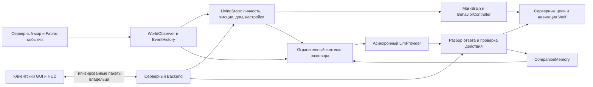

# Архитектура MarkAI

В 0.9.0 используется `CompanionRegistry`: основной ключ — UUID компаньона, отдельные индексы — владелец и UUID тела. Владелец имеет до восьми записей и один выбранный UUID. Сессии диалога и страницы памяти индексируются UUID компаньона. `CompanionStore` читает старый массив и новый формат schemaVersion=1; первая миграция сохраняет исходные байты, запись выполняется через временный файл и замену с ограниченным повтором при временной блокировке Windows.

Существующие групповые команды проходят как один `Action("all:<действие>")`. Сервер обходит только собственный реестр игрока соединения, один раз определяет цель атаки, проверяет каждый видимый загруженный экземпляр, сохраняет общий результат и не меняет выбор. Сбор использует штатные отдельные задания `WolfWorkRuntime` и реальные предметы. Карточки профиля получают только краткие данные своих соседних компаньонов; полная память относится к выбранному.

Генерация LLM по-прежнему выполняется по одному запросу. Панель учитывает занятость другим запросом и сохраняет неподготовленный к отправке текст; запоздалый ответ обновляет только свою историю, а статус в панели — только при совпадении текущего выбора. На время подтверждения переключения кнопки изменения состояния блокируются; при отказе/таймауте становятся доступны повторно.

Постоянный `CompanionIdentity.companionId` отделён от UUID физической сущности. Явное возрождение после зарегистрированной смерти создаёт новое тело волка с пустой сумкой, сохраняя личность, дом, память и навыки. У старых сохранений логическая личность первоначально берётся из прежнего UUID; выгрузка чанка не является смертью.

`LivingCompanionRuntime` выполняет решения мозга в мире. Простые команды проходят через `IntentParser` и `ActionValidator` сразу, сложная явная просьба допускает только действие из схемы LLM. Обычная беседа сохраняет режим движения даже при ошибочном выборе действия моделью. Прибытие подтверждается расстоянием, отдых — настоящей позой, движение — фактическим движением; недоступный путь имеет ограниченное время и явную ошибку. `GroundedFacts` берёт ответ на прямой запрос собственных координат из снимка движка.

Наблюдения существ и 405 блоков кэшируются на 20 тиков; сканирование не загружает чанки. Метрики доступны через `/mark debug`. Контекст AI ограничен 8192 символами, память — 3000 символами в контексте; сетевой снимок — 24576 символами, воспоминания — страницами по 16. HTTP, извлечение воспоминаний и журнал работают в фоновых ограниченных очередях. Небольшой мировой JSON записывается на серверном потоке при важных изменениях, раз в 200 тиков и при остановке: это файловое сохранение, не база данных.

`MarkAIMod` связывает Fabric-события, собственные команды, сохранение и реальные сущности. Компаньон остаётся обычным `Wolf`, приручённым владельцем по UUID. Только зарегистрированный компаньон получает дополнительные цели и маркер сумки; обычные волки сохраняют ванильное поведение.

## Поведение и наблюдение

`WorldObserver` собирает снимки игрока, окружения и видимых существ на серверном потоке. `WorldState`, `PlayerSnapshot`, `EnvironmentSnapshot` и `EntityObservation` содержат значения, а не передаваемые в фон живые сущности. `EventHistory` ограничивает, дедуплицирует и удаляет устаревшие события.

`LivingState` объединяет `PersonalityTraits`, `EmotionalState`, `CompanionSettings`, дом, историю событий, поведенческий контроллер и последний результат действия. Черты создаются для конкретной личности и сохраняются. `PersonalityEngine` преобразует их в пороги осторожности, интереса и отдыха. Эмоции меняются от наблюдаемых событий и постепенно восстанавливаются.

`BehaviorController` выбирает типизированную `Activity` по приоритету и удерживает переходы, чтобы избегать переключения на каждом тике. Команды представлены `CompanionAction`, результаты — `ActionResult`. Фактическую навигацию выполняет серверная интеграция с целями Minecraft; модель не рассчитывает путь. Бой использует возможности волка, а критическая опасность и низкое здоровье влияют на отступление.

## Разговор и память

`LlmProvider` — асинхронный контракт; `OllamaClient` использует локальный API Ollama, `OpenAiCompatibleProvider` — `/chat/completions`. `RetryingLlmProvider` повторяет временные ошибки с ограничениями. HTTP-провайдеры ограничивают тела ответов, очередь, время и вывод; перенаправления отключены. Отмена распространяется на активный запрос и отложенную попытку.

Контекст объединяет характер, эмоции, свежие наблюдения, недавние события, подходящие воспоминания и ограниченную историю. Простой `DialogueIntent` не позволяет обычному разговору случайно стать командой движения. Ответ проходит строгий разбор и серверную проверку; устаревшие ответы отклоняются после смены сущности, мира, поколения запроса или владельца.

Автоматическая речь отделена от ответа игроку: `AmbientConversation` ограничивает частоту, замечает крупные изменения обстановки и отсекает недавние повторы. Её контекст не содержит прежнюю переписку, старые команды и сохранённую точку дома; автоматические строки хранятся в отдельном непостоянном окне на восемь фраз. Действие принудительно `say`. Ручное сообщение отменяет свой ожидающий автоматический запрос, а выключение режима запрещает позднюю отправку.

`CompanionMemory` хранит записи `MemoryEntry` с UUID, временем, категорией, источником и достоверностью. Подтверждённые события мира отделены от слов игрока и производных сводок. Извлечение и сворачивание работают в ограниченном фоновом исполнителе; готовые неизменяемые результаты применяются вызывающим серверным кодом без ожидания. Поиск использует текст и метаданные, без внешней БД и векторного сервиса. Удаления учитываются при восстановлении, чтобы удалённая запись не появилась вновь из недавней переписки.

## Клиент, сеть и хранение

`MarkAIClient` загружается только клиентским entrypoint. `CompanionScreen` реализует пять вкладок и отправляет действия через `CompanionNetwork`; общие и серверные классы не обращаются к клиентским типам. `ClientCompanionState` хранит локальную копию последнего снимка, а не серверное право изменять данные.

Отдельные типы пакетов обслуживают запрос состояния, команду, сообщение, отмену, удаление памяти, настройку, снимок и уведомление. Пакеты ограничены кодеками и `NetworkRules`. Сервер использует игрока соединения, проверяет действия и владельца, ограничивает частоту и отвечает только этому игроку. HUD и открытое окно обновляются не чаще раза в секунду; воспоминания выдаются страницами.

Мировой JSON хранит состояние компаньонов; API-настройки находятся вне сохранения мира. `WolfInventoryMixin` добавляет синхронизированный маркер и ленивый `DogInventory`, сохраняет предметы штатным `ContainerHelper` и однократно выбрасывает их после смерти. `ChatJournal` пишет ограниченный локальный JSONL с парными запросами и результатами. Сохранение, отмена задач и закрытие ресурсов привязаны к жизненному циклу сервера.

Ожидающий ручной вопрос хранится временно в AISession конкретного компаньона и добавляется в messages серверного снимка панели. Незавершённая пара не записывается в CompanionMemory: после успеха сохраняется обычный обмен, а временный вопрос очищается при завершении или отмене. Автоматический диалог не создаёт строку игрока.

## Общая панель и разговор 0.10.0

CompanionHubScreen открывает общий реестр, групповой чат и массовые настройки. GroupChat — отдельный ограниченный пакет с владельцем из соединения; bulk-настройки допускают только hud, defense, autochat и follow_distance. Переключение личной карточки подтверждается серверным снимком, не локальной подменой данных.

GroupDialogueRound создаётся только сообщением игрока. Он хранит общий бюджет десяти ходов и очередь адресатов по UUID. Именной вопрос питомца может продолжить только существующий разговор, не создать новый и не сбросить бюджет. Сохраняются инициирующая тема, конкретный автор вопроса и подписанная общая история. Упоминание имени в обычном утверждении не продолжает беседу. Имена сравниваются как литералы с границами слов; при пересечении побеждает более длинное имя, поэтому «Марк 2» не вызывает «Марка».

Запросы идут последовательно через существующий провайдер. Групповая генерация учитывает общий лимит занятости, отмену, смену мира, владельца и тела сущности. Ошибка подготовки освобождает разговор. Все модельные действия ограничиваются речью; только явный текущий приказ игрока может пройти детерминированный исполнитель. Недостающее имя адресата добавляется из реестра с сохранением ограничения длины, а явное обращение к новому собеседнику не переписывается.

GroupChatState хранится в необязательном поле groups существующего CompanionStore schemaVersion=1: предпочтения и последние 24 сообщения для каждого владельца. Приватные CompanionMemory не объединяются. Без memoryEnabled сохраняются только предпочтения. Новые генерации не запускаются по ванильному чату; именная маршрутизация ограничена групповой вкладкой.
